# Cueline

### Give new life to your CDJ-2000NXS2

[](LICENSE)
[](https://github.com/feers77/cueline/releases)

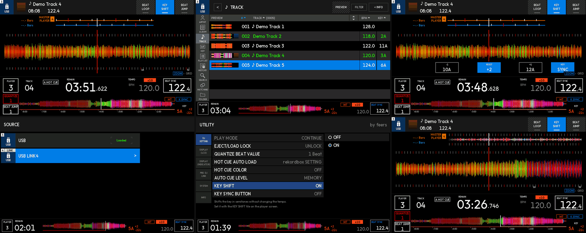

Cueline is a custom firmware UI for the Pioneer CDJ-2000NXS2, inspired by the CDJ-3000. It brings 3000-style
screens and waveforms, KEY SHIFT and KEY SYNC, Link Cue previews and more to the NXS2. You build it yourself from
the official 1.87 update, in a few minutes, and you can go back to stock at any time.

> [!WARNING]
> **Cueline 2.1 is a PRE-RELEASE.** It has been fully tested in our emulator but **not yet confirmed on real
> decks**. Keep the official 1.87 update to [go back to stock](#going-back-to-stock), and **test at home before a
> gig**. If you need a version already used on real decks, stay on the
> [1.92 beta](https://github.com/feers77/cueline/releases/tag/v1.92.0-beta) for now.

**This version: Cueline 2.1 (pre-release).** Build `Cueline-2.1 e2a70b09` (RELEASE), device version MAIN 2.10 /
GUI 2.04; developer build `V4n21` (DEV). Cueline uses the deck's own version numbers (2.1 → MAIN 2.10).
It may contain bugs: screens that draw wrong, features that misbehave, in rare cases a deck that needs a restart.
Please [report bugs](#reporting-bugs-and-contributing). Cueline is unofficial and **not affiliated with or endorsed
by Pioneer DJ or AlphaTheta**.

### Highlights
- ⚡ **59–60 fps player screen** — smooth, CDJ-3000-style scrolling waveforms driven by the NXS2's own display
  hardware (a hardware scroll layer, not CPU redraws). The stock NXS2 UI never moved like this.
- 🎨 **CDJ-3000-style UI** — player, browse with mini waveforms, SOURCE/LINK list, INFO, SHORT CUT and UTILITY
  screens; RGB, 3BAND and BLUE waveforms; 6 zoom levels; own Cueline Sans font and icons.
- 🎹 **KEY SHIFT and KEY SYNC** — our own pitch-shifting engine on the deck's DSP (±12 semitones, tempo unchanged),
  KEY SYNC to the master's sounding key including cents — also with a **CDJ-3000 on the LINK**, both directions.
- 👂 **Link Cue** — preview any track in your list (local or over Pro DJ Link) before loading it.
- 👆 **Full touch** — tap and drag in lists, pop-ups, UTILITY, KEY SHIFT and GRID ADJUST panels, like the CDJ-3000.
- 🌊 **LINK phase meter with the master's waveform** — 4 BARS, PHASE or WAVEFORM; the WAVEFORM view runs on its
  own display hardware layer at full width, and the meter follows the main waveform's zoom scale, like the CDJ-3000.
- 🔁 **Pro DJ Link compatible** — still a CDJ-2000NXS2 on the network; DJMs, rekordbox and unknown devices get
  exactly the stock status packet, stock NXS2s accept ours unchanged (tested). A CDJ-3000 can show a
  Cueline master's waveform *(tested against a CDJ-3000 emulator only)*.
- 🛟 **Safe to try** — built from the official 1.87 on your own computer, reproducible byte for byte, and the official
  update brings you back to stock.

### New in 2.1
- **Settings survive power-off again (bug fix):** KEY SHIFT, KEY SYNC, CLASSIC and BEAT JUMP no longer come back
  changed after switching the deck off; settings are stored in a versioned, checksummed record.
- **Stock pop-ups drawn correctly:** MY SETTINGS, REMOVE ALL TRACKS and the other deck dialogs show in their normal
  place, with the selected option readable.
- **Green KEY on the selected row** and **hot-cue badges on the browse strip**, as on the CDJ-3000.
- **Preview gesture:** the row you press stays the previewed track for the whole gesture (CDJ-3000 style).
- **Update safety** extended to the 3BAND waveform code; diagnostics for the master's waveform over LINK.
- **[Cueline Web Builder](https://feers77.github.io/cueline/webbuilder/)** (build in your browser) and a **macOS app**.
- **Versioning:** MAIN 2.10 / GUI 2.04; UTILITY → INFO → BUILD shows `Cueline-2.1 e2a70b09`.
- Details: [CHANGELOG.md](CHANGELOG.md) and [RELEASE_NOTES_v2.1.md](RELEASE_NOTES_v2.1.md).

> **No Pioneer DJ / AlphaTheta files are in this repository**: no firmware or `.UPD`, nothing extracted from any
> firmware (images, binaries, fonts, icons, skins) and no keys. Everything here is our own work or open-source
> third-party code ([THIRD_PARTY.md](THIRD_PARTY.md)). You download the official update from Pioneer DJ; the
> build reads it on your own computer and checks it before using it.

> ⚠️ **Use at your own risk.** Bricking a CDJ-2000NXS2 is hard but not impossible. The main risk is a power cut while
> the update is being written. Use a UPS if you can, don't touch the deck or the USB stick during the update, and
> keep the official 1.87 update to go back to stock. Unofficial, provided as-is, without warranty ([LICENSE](LICENSE)).

> 🧪 **Community testing release (pre-release).** It very likely has bugs. Please report them in
> [Issues](https://github.com/feers77/cueline/issues) and send fixes or features as pull requests: we review them
> and merge what works ([CONTRIBUTING.md](CONTRIBUTING.md)).

**Contents:** [Quick start](#quick-start) · [Features](#features) · [Screenshots](#screenshots) ·
[Pro DJ Link](#pro-dj-link-compatibility) · [Known behavior and limits](#known-behavior-and-limits) ·
[Back to stock](#going-back-to-stock) · [DEV build](#dev-build-for-testers-and-contributors) ·
[Build from source](#build-from-source) · [AI assistant](#using-an-ai-assistant) ·
[Community](#community) · [Bugs and contributing](#reporting-bugs-and-contributing) · [Downloads](#verify-the-downloads) ·
[License](#license-and-trademarks) · [Credits](#credits)

## Quick start
You need: the deck, a computer, and a small USB stick (FAT32).
1. **Get the official update.** Download the CDJ-2000NXS2 firmware **1.87** from the Pioneer DJ website and unzip
   it. You get a file named `C2KNXS2.UPD`.
2. **Build Cueline** — pick one (all give the same, verified file):
   - **EASY — in your browser:** open **[Cueline Web Builder](https://feers77.github.io/cueline/webbuilder/)**, drop your `C2KNXS2.UPD` and click
     **Download**. Nothing to install, any computer (Windows, macOS, Linux). Your file never leaves your computer:
     everything runs inside the browser page.
   - **App:** from the [Releases page](https://github.com/feers77/cueline/releases), `CuelineBuilder.exe` (Windows)
     or `CuelineBuilder-macOS.zip` (macOS, Intel and Apple Silicon; see [Easy install on macOS](#easy-install-on-macos)
     the first time). Drag `C2KNXS2.UPD` onto it, or open it and pick the file. It writes `Cueline/C2KNXS2.UPD`
     next to your file.
   - **Linux / Python:** `python3 builder/cueline_patch.py /path/to/C2KNXS2.UPD`.
3. **Copy** the built `C2KNXS2.UPD`, alone, to the root of the USB stick.
4. **Factory reset the deck first:** disconnect the Pro DJ Link (LAN) cable (while LINK is active the player does
   not allow DUPLICATION → DEFAULT), then **UTILITY → DUPLICATION → DEFAULT** ([why](#install)).
5. **Install** it like an official update ([details](#install)). Never switch the deck off during the update.
6. **Check** UTILITY → INFO → BUILD: it shows `Cueline-2.1 e2a70b09`.

To go back to the official firmware, see [Going back to stock](#going-back-to-stock).

### Easy install on macOS
1. Download `CuelineBuilder-macOS.zip` from the [Releases page](https://github.com/feers77/cueline/releases)
   and double-click it to unzip: you get `CuelineBuilder.app`. (Or skip all this and use the web builder above.)
2. The app is not notarized by Apple, so the first time macOS blocks it ("cannot be opened" / "could not verify").
   Open **System Settings → Privacy & Security**, scroll down and click **Open Anyway** next to CuelineBuilder,
   then confirm. You only do this once.
3. Drag your official `C2KNXS2.UPD` onto `CuelineBuilder.app` (or double-click the app, click **Continue** and pick
   the file). When it finishes, click **Show in Finder**: your file is `Cueline/C2KNXS2.UPD` next to the original.

### Install
1. If you use MY SETTINGS, save them with rekordbox first, and write down your deck settings: the next step erases
   them.
2. **Disconnect the Pro DJ Link (LAN) cable first: while LINK is active the player does not allow DUPLICATION →
   DEFAULT.** Then **UTILITY → DUPLICATION → DEFAULT** (factory reset). The deck only installs an update whose
   version is newer than the one it remembers; the reset clears that memory, so the update is never skipped. It is
   **required** if the deck has had an earlier Cueline test build with a higher version number (2.1 would be
   skipped), a DEV build, another custom firmware, or a Cueline build with the same or a higher version; we recommend it always.
3. Put only the new `C2KNXS2.UPD` in the root of a small FAT32 USB stick.
4. With the deck off, insert the stick and start the update exactly as Pioneer DJ's CDJ-2000NXS2 update guide
   describes. Wait until it shows 100 % / complete, then switch the deck off and on.
5. UTILITY → INFO → BUILD shows `Cueline-2.1 e2a70b09`. If the deck still shows the old build, the update was skipped:
   repeat step 2 and install again.
6. Test it at home (load, play, browse, your LINK setup) before using it at a gig.

## Features
Tags: **[LINK]** needs Pro DJ Link (decks connected by network) · **[A9]** needs a DJM-A9 mixer ·
**[3000]** needs a CDJ-3000 on the LINK · *(not yet on a real deck)* = checked in our test environment only.
How to use each feature: [docs/USER_GUIDE.md](docs/USER_GUIDE.md).

**Screens (CDJ-3000 style)**
- Player screen with artwork, key and length; BPM box with MASTER and BEAT SYNC; status boxes.
- BROWSE with an icon rail, column headers and rows with mini waveform, artwork, BPM and KEY.
- SOURCE list (LINK key): your SD / USB, then every medium on the LINK **[LINK]**.
- INFO, SHORT CUT, MENU pop-ups, TRACK FILTER, MY TAG, SEARCH and TAG LIST in the 3000 layout.
- Touch lists: tap, drag, flick, LOAD button; loaded / played / previewed rows in color.
- UTILITY in the six CDJ-3000 categories, with a help text for every Cueline setting.
- Smooth screens: player, MENU, SHORT CUT and INFO at 60 fps; clean track loads *(not yet on a real deck)*.
- LIGHT MODE day theme; BPM with one or two decimals.
- Our own open font, Cueline Sans, and our own 3000-style icons.

**Waveforms**
- Detail waveform on the display's hardware layer: smooth 1-pixel scrolling at 60 fps (needs rekordbox analysis).
- Six zoom levels, as on the CDJ-3000; zoom changes show at once.
- 3BAND / RGB / BLUE colors (UTILITY → WAVEFORM COLOR) and WAVEFORM FULL / HALF shapes for the overview and the
  browse mini waveforms (FULL = drawn up from the bottom, HALF = mirrored).
- Beat grid with red downbeats, beat numbers, loop shading, slip ghost (where the track really is during SLIP).
- Cue, loop and memory markers in rekordbox colors, with comments; HOT CUE COLOR.
- Overview strip with badges, ruler and tap-to-search.

**Key**
- KEY FORMAT: ALPHANUMERIC (8A) or CLASSIC (Am), everywhere.
- KEY SHIFT −12 … +12 semitones with our own engine *(sound quality not yet judged on a real deck)*.
- KEY SYNC to NXS2 masters **[LINK]** and to CDJ-3000 masters **[LINK] [3000]** *(3000: emulator only)*.
- KEY SYNC BUTTON: use the HOT CUE D/H pad as a KEY SYNC key, with a status lamp **[LINK]**.
- Harmonic key colors: green when your key fits the master's **[LINK]**.

**Tempo and sync**
- Tempo takeover after SYNC off: an arrow shows which way to move the tempo fader.
- Phase meter: PHASE / WAVEFORM / 4 BARS on the main waveform's scale; the WAVEFORM view shows the tempo master's
  waveform on its own display hardware layer (GR1) **[LINK]**.
- LINK OFFSET (UTILITY → PRO DJ LINK): shifts the meter's master line by −10 … +55 ms; default OFF **[LINK]**.
- With a CDJ-3000: precise-position (0x0b) packets both ways, and the 3000 can show a Cueline master's waveform
  **[LINK] [3000]** *(emulator only)*.
- Cue countdowns for your deck and the master **[LINK]**.
- BEAT JUMP 1–64 beats; BEAT LOOP and BEAT JUMP pads.
- Players 5 and 6 **[LINK]** (with gear that supports them).

**Link Cue and audio**
- Link Cue: hold a browse row to hear the track on the mixer's LINK CUE before loading it; MP3 / FLAC / WAV
  **[LINK] [A9]**.
- Touch Cue: preview from the overview strip **[LINK] [A9]** *(not yet on a real deck)*.
- WAV 32-bit playback (integer and float).

**Safety and support**
- Update-safe: Cueline's code stays inactive in update mode, so updates use Pioneer's own updater.
- Kill switches that turn single features back to stock, live, to isolate a problem: in the DEV build only.
- UTILITY → INFO → BUILD shows the installed build.
- Menus in English and Spanish only, to free firmware space. If you need another language, stay on the official
  firmware.

## Screenshots
| | |
|---|---|
| 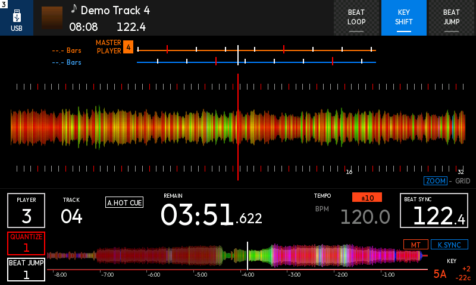 | 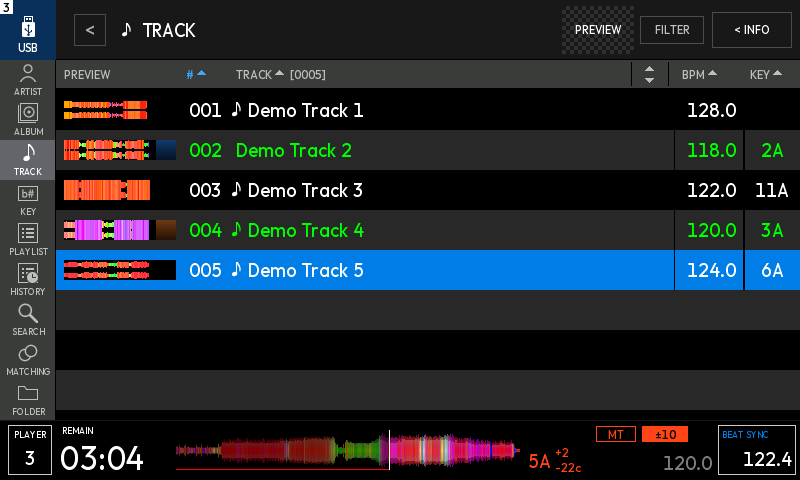 |
| **Player**: RGB waveform, KEY SHIFT amount, MT and K.SYNC badges | **Browse**: mini waveforms, BPM and KEY columns |
| 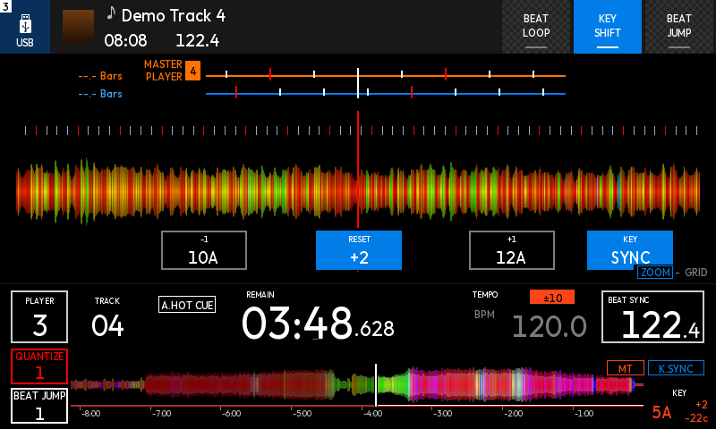 | 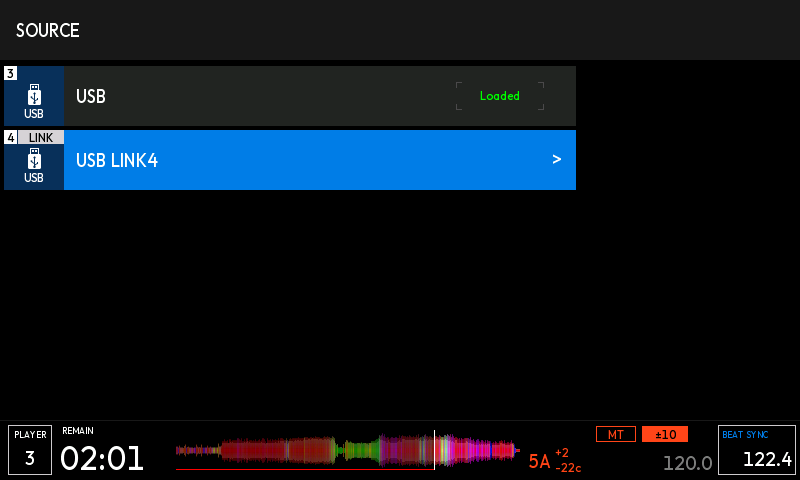 |
| **KEY SHIFT panel**: touch tiles, RESET, KEY SYNC | **SOURCE**: your media and other players' media over LINK |
| 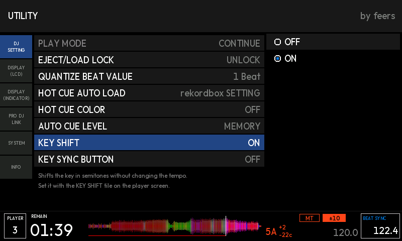 | 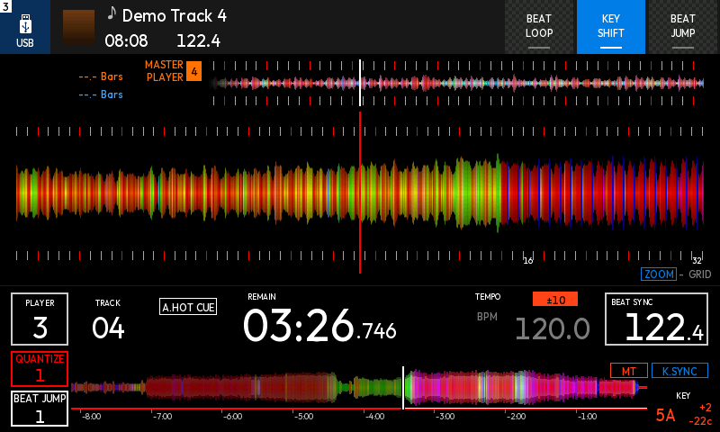 |
| **UTILITY**: CDJ-3000 categories with help texts | **Phase meter (WAVEFORM)**: the master's waveform over LINK |
| 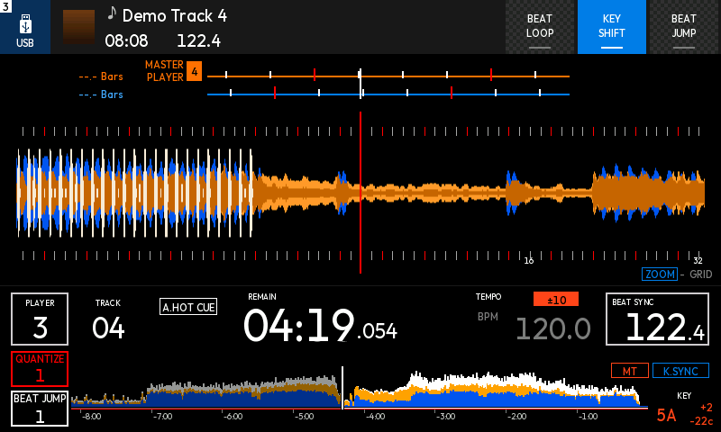 | 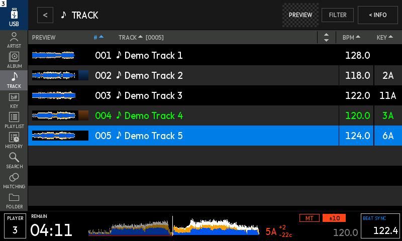 |
| **Player in 3BAND** | **Browse in 3BAND** |
| 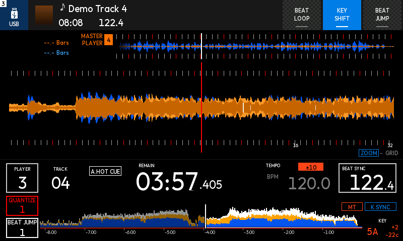 | 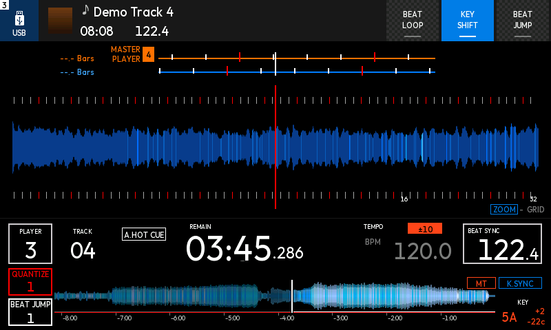 |
| **Phase meter following the master** | **Player in BLUE** |

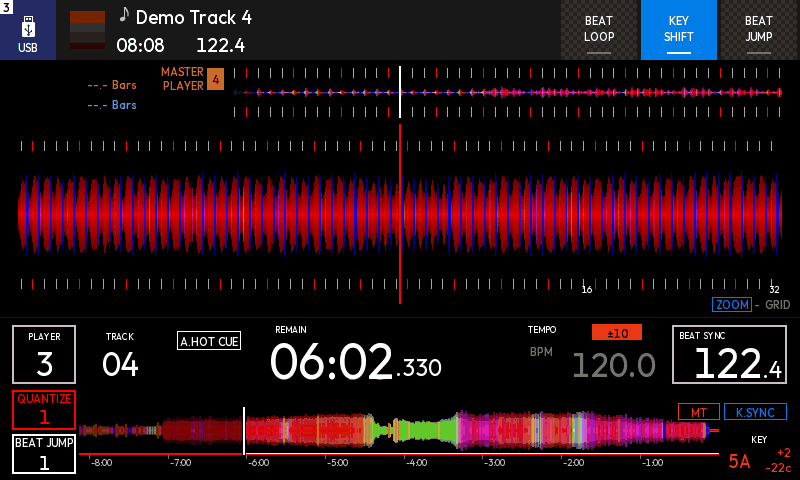

*Screenshots from our test environment with neutral demo tracks. Photos of real decks will follow.*

## Pro DJ Link compatibility
- On the network, Cueline appears as a stock CDJ-2000NXS2 (model name, firmware 1.87, stock keep-alive packet).
- Each device gets the status format it understands: CDJ-3000s get the 3000 format with our key fields (so their
  KEY SYNC can follow a Cueline master); NXS2 decks get the NXS2 format plus our key fields; mixers, rekordbox and
  other devices get the exact stock status.
- **Tested with:** stock CDJ-2000NXS2 decks (SYNC, tempo follow, master handoff and LINK loads both ways); a real
  DJM-A9 (Link Cue); a CDJ-3000 **in an emulator only** (original firmware 3.22).
- **Have a real CDJ-3000 or CDJ-3000X?** Please run the checklist in
  [docs/COMPATIBILITY.md](docs/COMPATIBILITY.md) and report the results in an issue.

## Known behavior and limits
**Same as the stock firmware.** Cueline does not change how the tempo master is handed over:
- Two decks playing: pressing **MASTER** on the current master hands master to the other playing deck. With the
  decks stopped, the deck stays master.
- Pausing the master hands master to a deck that is still playing.
- Loading a track on a lone deck makes it the master.

**Not yet verified on real hardware:** everything with a real CDJ-3000 / CDJ-3000X (0x0b packets, the 3000
showing our waveform, KEY SYNC with a 3000: tested in an emulator only), Touch Cue, and some fixes in this release that our
emulator could not reproduce (they come from reading the code).

**Limits**
- KEY SHIFT adds a little latency (about 23 ms measured on the previous engine) and can still sound phasey at
  large shifts.
- The meter's PHASE and 4 BARS views are drawn by the CPU (unchanged).
- The WAVEFORM meter may sit 1 pixel row off vertically.
- A CDJ-3000 does not show the key of tracks loaded from a Cueline deck's media.
- The phase meter WAVEFORM view stays empty for a CDJ-3000 master playing from SD (its beat grid still shows).
- Link Cue needs a DJM-A9 and plays MP3 / FLAC / WAV only.
- GRID ADJUST changes the display only. The BEAT NUMBERS and GRID ADJUST settings are not saved.
- Some settings (WAVEFORM, KEY FORMAT, KEY SHIFT, KEY SYNC BUTTON, BEAT JUMP) are saved only with a HISTORY NAME
  of 29 characters or fewer.
- With KEY SYNC BUTTON on, hot cues D and H are not available from that pad.
- A stock NXS2 does not share its media with players 5 and 6.

Full list: [docs/KNOWN_LIMITS.md](docs/KNOWN_LIMITS.md). Questions: [docs/FAQ.md](docs/FAQ.md).

## Going back to stock
1. **Why a reset is needed:** Cueline has a higher version number than Pioneer's update, and the deck only installs
   *newer* versions. A factory reset clears the installed version.
2. **Disconnect the Pro DJ Link (LAN) cable first: while LINK is active the player does not allow DUPLICATION →
   DEFAULT.** Then, **on the deck: UTILITY → DUPLICATION → DEFAULT** (factory reset). It also resets your deck settings: write them
   down first, or save MY SETTINGS with rekordbox.
3. Put the official `C2KNXS2.UPD` 1.87 **alone** on a FAT32 stick and install it like any official update. Same
   cautions: no power cut, don't touch the deck or the stick.
4. Check **UTILITY → VERSION**: it shows **1.87**, and the screens are Pioneer's again.

- The official update restores the stock firmware completely. In our tests on real decks, future official updates
  then installed normally.
- If the update is skipped (nothing is written), do the factory reset again and repeat step 3.
- If an update is interrupted, leave the stick with the official `C2KNXS2.UPD` in: the deck's emergency updater
  recovers at the next power-on.
- Step by step: [docs/back_to_stock.txt](docs/back_to_stock.txt).

## DEV build (for testers and contributors)
The **DEV** build has every feature of the normal (**RELEASE**) build **plus diagnostics**: a BLACK BOX event
recorder (`BLACKBOX.BIN` on the stick), a test log over USB or the network, a network commander, extra kill
switches, performance counters and automated tests. **Not for gigs**, and use it only on your own network: a
computer on the same LINK network can query and operate a DEV deck.
- Build it from source: `PROFILE=dev ./build.sh /path/to/C2KNXS2.UPD` (expected sha256 for this version:
  `c8d39cbeb6ad78e26e23d6aa3b5c2c51c571124fefb0fed9098cbcdfc8012610`). Cueline Builder makes RELEASE builds only.
- Install it like RELEASE. DEV and RELEASE carry the same version number, so switching between them needs
  UTILITY → DUPLICATION → DEFAULT first (LAN cable disconnected).
- Everything else, including how to capture logs for a bug report and a privacy note:
  [dev/README.md](dev/README.md).

## Build from source
Builds every component yourself; the result is byte-identical to what Cueline Builder makes.
1. A Linux computer (Ubuntu 24.04 is the reference) or Windows 10/11 with WSL (Ubuntu). On macOS, use a Linux
   virtual machine or Docker.
2. Install the tools:
   ```
   sudo apt install gcc-sh4-linux-gnu binutils-sh4-linux-gnu python3 python3-pil python3-numpy python3-fonttools
   ```
3. Build (in this folder):
   ```
   ./build.sh /path/to/C2KNXS2.UPD
   ```
4. The result is `out-release/C2KNXS2.UPD`. The script prints `verify ... all checks passed` and `bootcheck PASS`,
   and compares the result with the reference sha256 `3b85d55f05052ad0cc376a807114d6bf218be2d50483c0038b1d66afcbb5cd23`.
   Exit code 0 = identical, 2 = built but different (other tool versions; still checked), 1 = error.
   **Never install a build whose verify or boot check failed.**

## Using an AI assistant
An AI coding assistant running on your computer can do the build for you. Give it this prompt:
```
Clone https://github.com/feers77/cueline, read README.md and AGENTS.md, and check the prerequisites.
Ask me for the path to my official CDJ-2000NXS2 1.87 C2KNXS2.UPD, verify its sha256, run the build,
and tell me where the output .UPD is, how to install it, and how to go back to stock.
Never modify, upload or share Pioneer files, and never flash anything yourself.
```
[AGENTS.md](AGENTS.md) has the exact steps, expected outputs and common fixes for the assistant.

## Community
Join the Cueline Discord for help, bug reports and beta testing: https://discord.gg/UHfG94zeW. Please also file
bugs in [Issues](https://github.com/feers77/cueline/issues), so they are tracked.

## Reporting bugs and contributing
**Bugs:** open an [issue](https://github.com/feers77/cueline/issues) with the Bug report template. Include the
BUILD id (UTILITY → INFO → BUILD), your setup (decks, mixer, Pro DJ Link or not), the file format, what you did,
what you expected and what happened; a phone video helps. Say whether it also happens with the official firmware
if you can check. For hard-to-catch bugs we may ask you to try the [DEV build](#dev-build-for-testers-and-contributors).

**Contributing:** fixes and features are welcome as pull requests. Start with [CONTRIBUTING.md](CONTRIBUTING.md),
then [dev/README.md](dev/README.md) and [docs/dev/](docs/dev/) (architecture, build pipeline, every mod, testing).
The emulator we use for development is not part of this repository.

## Verify the downloads
| File | sha256 |
|---|---|
| Official `C2KNXS2.UPD` 1.87 (your input) | `f211191a573b7a5c0e694936871f76011a58d5861dd061301cdb0d8b83a8b3e5` |
| `CuelineBuilder.exe` (Release asset) | `decce828bcf59ef972ec2ee7e69f8c191e8823bd6407a3ce54eecc4f5f60eada` |
| `CuelineBuilder-macOS.zip` (Release asset) | `9fd5d5af7ad883e5bae6daa6c2e962e7de36b809d409709857ff46d50037637d` |
| `builder/cueline.delta` (our patch data) | `89230d1afbd6bad2b11432c953779cd087596cc425fcea4091b97aeccda37344` |
| Your built `C2KNXS2.UPD` (Builder or `build.sh`) | `3b85d55f05052ad0cc376a807114d6bf218be2d50483c0038b1d66afcbb5cd23` |

- Windows may warn about an unsigned program (SmartScreen or antivirus). If you prefer not to run it, use the
  Python script or build from source: all three give the same result.
- Extra check: build from source, then run
  `python3 builder/mkdelta.py /path/to/C2KNXS2.UPD out-release/C2KNXS2.UPD my.delta --release V4r21 --build-id "Cueline-2.1 20261120-1459 e2a70b09"`
  and compare `my.delta` with `builder/cueline.delta`. To rebuild the exe yourself, see `builder/build_exe.bat`.

## License and trademarks
- **Our code:** Apache-2.0 ([LICENSE](LICENSE), [NOTICE](NOTICE)). **Docs:** CC BY 4.0.
- **Upstream code** (the patcher core, from github.com/Stijn-Jacobs/cdj-nxs2-qemu): GPL-2.0-or-later
  ([LICENSES/GPL-2.0.txt](LICENSES/GPL-2.0.txt)). The build tooling as a whole is GPL-3.0-or-later (combined
  work); our own files are Apache-2.0.
- **Fonts and other third-party parts:** [THIRD_PARTY.md](THIRD_PARTY.md).
- Cueline is an independent project, **not affiliated with or endorsed by Pioneer DJ or AlphaTheta**. "CDJ",
  "DJM", "Pioneer DJ", "AlphaTheta" and "rekordbox" are trademarks of their respective owners, used here only to
  describe what this project works with.

## Credits
- **Stijn Jacobs and contributors** for [cdj-nxs2-qemu](https://github.com/Stijn-Jacobs/cdj-nxs2-qemu), the
  open-source CDJ-2000NXS2 emulator and patcher this project started from.
- **The CDJ-2000NXS2 modding community**.
- Everyone who tests, reports bugs and contributes.
